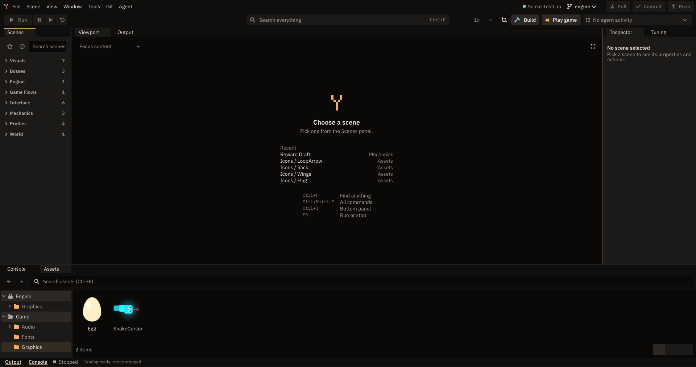

<div align="center">

# Build the game you wish existed

**A bright, agentic game engine for turning playful ideas into games.**

[](https://github.com/YADIENGINE/yadien/releases/latest/download/YADIEN-Setup.exe)
[](https://github.com/YADIENGINE/yadien/releases)
[](LICENSE)

**[Download the latest installer](https://github.com/YADIENGINE/yadien/releases/latest/download/YADIEN-Setup.exe)** · Windows desktop

</div>

The engine is built to be driven by your own AI agent. Claude Code, Codex, or any other CLI agent writes the game code, opens
the result in the live editor, looks at it, and fixes what it sees.

> The engine is in `0.x` beta. Releases are not code-signed yet, so Windows SmartScreen may ask you to choose
> **More info → Run anyway** during installation.



## 🌱 Make your first project

1. Download and run [`YADIEN-Setup.exe`](https://github.com/YADIENGINE/yadien/releases/latest/download/YADIEN-Setup.exe).
2. Install and start a **New project**.
3. Connect your agent: add one line to your agent file. For Claude, add in `CLAUDE.md`; for others, add to `AGENTS.md`:

   ```text
   @Engine/AgentDocs/Agent.md
   ```

That is it!

## 🤖 YADIEN is agentic!

An agent usually works blind: it edits code and hopes. YADIEN closes the loop. You keep the editor open and ask
for a change; the agent does the rest!

| | |
| --- | --- |
| 🔌 **Bring your own agent** | The editor's Console runs Claude Code, Codex, or a custom command. No MCP is needed. |
| 👀 **Agents see the result** | Agents can see the editor screen when they need to. |
| 📍 **You point, it reads** | Mark a region in the editor and agent can check it. No more "look at this!" explanations. |
| 🔊 **Agents analyse sounds** | Agents can analyse sounds using engine. |
| 🎵 **Agents can generate sounds** | Agents can generate sound effects using engine. |
| 📝 **Everything can be text** | Graphics can be drawn in code, sounds can be generated with Python, and tuning lives in JSON, so an agent can author content without external tools or ready-made assets. |
| 📟 **Feedback is machine-readable** | Failed builds list `file:line` errors, tests write `results.json`, and `ctl` answers in JSON with fixed exit codes. |
| 🔁 **Agents replay and test** | Gameplay can run in fixed steps without a window, so an agent can replay a run, check it by hash, and test scenarios. |
| 🎛️ **You stay in control** | Several Console sessions with live agent state, progress notes, and an Agent control switch that makes the editor read-only to agents. |

You are the brain, agents are the muscles!

## ✨ Why make a game here?

| | |
| --- | --- |
| 🤖 **Agentic** | You design the game, and your agents build it. |
| 🔓 **Open Source** | MIT licensed and completely free. |
| 📦 **Premade Modules** | Saves, localization, scoreboards, and more, with new modules on the way. |
| 🎨 **No art needed to start** | Draw graphics in code and generate sounds with Python. |
| 🛡️ **Safe upgrades** | Try a new engine version on a copy of your project before you commit to it. |
| 🚢 **Ready to ship** | Package a Windows build of your game, and only the sounds it uses go in. |
| 💻 **Plain C++** | Your game is ordinary C++ code, so your tools and your agents already know it. |


## 🧩 What comes in the box

**In the engine:**

- **Rendering:** Draw shapes, paths, and Unicode text in code, with bloom when you want it.
- **UI:** Build menus and HUDs from ready-made widgets that play their own sounds.
- **Collision:** Check what hits what, without setting up a physics world.
- **Animation:** Make things pop in, glide, and recoil, or play a whole sequence on cue.
- **Camera:** Follow the player, stay inside the level, or split the screen.
- **Effects:** Add particles, screen shake, transitions, hitstop, and slow motion.
- **Runtime:** Scenes, input, audio, and saves are ready to use.
- **Gameplay helpers:** Drop in stat modifiers, timed effects, tiered goals, and weighted picks.
- **Editor:** Drag a value in the Inspector and watch it change in the live scene.
- **Toolchain:** Create, build, test, and package a game from one command line tool.

**Optional modules**, linked only when your game asks for them
([all modules](https://github.com/YADIENGINE/engine/blob/main/Docs/Modules/README.md)):

| Module | Use it for |
| --- | --- |
| [JsonIO](https://github.com/YADIENGINE/engine/blob/main/Docs/Modules/JsonIO/README.md) | JSON documents and files, atomic writes, encryption, gzip |
| [Persistence](https://github.com/YADIENGINE/engine/blob/main/Docs/Modules/Persistence/README.md) | Persistent key/value saves with backup and recovery |
| [Localization](https://github.com/YADIENGINE/engine/blob/main/Docs/Modules/Localization/README.md) | Language catalogs, fallback, placeholders, number formatting |
| [ScoreBoard](https://github.com/YADIENGINE/engine/blob/main/Docs/Modules/ScoreBoard/README.md) | Score history, ranking, and game-defined validation |
| [RunTracking](https://github.com/YADIENGINE/engine/blob/main/Docs/Modules/RunTracking/README.md) | Compressed JSON archive of play sessions |
| [Version](https://github.com/YADIENGINE/engine/blob/main/Docs/Modules/Version/README.md) | Installed-version changes and patch-note queries |
| [Popup](https://github.com/YADIENGINE/engine/blob/main/Docs/Modules/Popup/README.md) | Animated drawing callbacks with lifetimes, motion, and handles |
| [NumberPopup](https://github.com/YADIENGINE/engine/blob/main/Docs/Modules/NumberPopup/README.md) | Numeric feedback, label formatting, accumulation, and local juice |
| [Profiler](https://github.com/YADIENGINE/engine/blob/main/Docs/Modules/Profiler/README.md) | CPU/GPU measurement, frame statistics, and performance comparisons |

## 📚 Pick up where your idea takes you

### Making a game

- [Engine handbook](https://github.com/YADIENGINE/engine/blob/main/Docs/README.md) — the starting point for all engine documentation.
- [Your first game](https://github.com/YADIENGINE/engine/blob/main/Docs/GettingStarted.md) — create a scene, draw, and respond to input.
- [Using an AI agent](https://github.com/YADIENGINE/engine/blob/main/Docs/ProjectSetup.md#using-an-ai-agent) — connect your agent to a project.
- [Editor automation](https://github.com/YADIENGINE/engine/blob/main/Docs/Editor/Automation.md) — every command an agent can use to drive the editor.
- [Editor guide](https://github.com/YADIENGINE/engine/blob/main/Docs/Editor/README.md) — connect live editor scenes and tune your game visually.
- [Graphics guide](https://github.com/YADIENGINE/engine/blob/main/Docs/Graphics/README.md) — rendering, text, themes, and effects.
- [UI](https://github.com/YADIENGINE/engine/blob/main/Docs/Ui.md) — menus, dialogs, panels, and HUD.
- [Collision](https://github.com/YADIENGINE/engine/blob/main/Docs/Collision.md) — shapes, queries, and the collision world.
- [Animation](https://github.com/YADIENGINE/engine/blob/main/Docs/Animation.md) — curves, timelines, tweens, and clips.
- [Camera](https://github.com/YADIENGINE/engine/blob/main/Docs/Camera.md) — follow, limits, and split screen.
- [Simulation](https://github.com/YADIENGINE/engine/blob/main/Docs/Simulation.md) — fixed steps, replays, and scenario tests.
- [Tuning values](https://github.com/YADIENGINE/engine/blob/main/Docs/Tuning.md) — adjust game feel without rebuilding.
- [Packaging a release](https://github.com/YADIENGINE/engine/blob/main/Docs/Release.md) — prepare a Windows build and its notices.

### Contribution

Want to help improve YADIEN? Start with the [contribution hub](Docs/Contribution.md).
